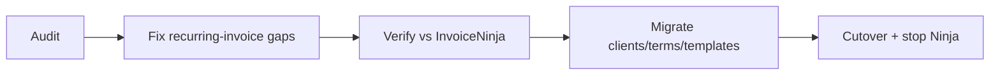

# Billing Go-Live — Plan

Intent: `docs/billing-go-live/intent.md`
Branch: `main` (push directly, per project convention)

Scope per intent: full InvoiceNinja cutover, no open balances to reconcile, top priority is accurate recurring-invoice generation and delivery. PayFast deferred.

## 1. Audit

**Goal:** Findings list. No code changed yet.

- Read `app/Modules/Billing/Services/RecurringInvoiceService.php`, `DueDateCalculator`, `ProRataCalculator`, `GenerateRecurringInvoices` console command.
- Pull every active InvoiceNinja recurring template (frequency, terms, line items, discounts). Memory flags discount-reconstruction bugs already fixed 2026-07-14 — re-check not regressed.
- Run full suite + `documents:verify-audit-trail`, note red flags.
- Check mail delivery path (sendmail → msmtp) actually reaches real client inboxes, not just the local queue.

**Verify:** written findings list; nothing in the codebase changed.

## 2. Fix gaps found

**Goal:** Each failing case now passes, with a test added.

- Any template type Ninja supports that `RecurringInvoice` enum/model doesn't (custom frequency, mid-cycle changes).
- Known open bug: WHMCS paid-signal/AccountResolver inconsistency — confirm it's irrelevant to this Ninja cutover (per intent's open question), or fix it if it turns out to matter.

**Verify:** `php artisan test --compact` green for touched areas; `vendor/bin/pint --dirty` clean.

## 3. Verify accuracy

**Goal:** Side-by-side match against real InvoiceNinja output.

> [!WARNING]
> No real client must receive an email before go-live is confirmed. Before any test run today, confirm `MAIL_MAILER` is set to `log` (or another non-delivering driver) in this environment, or run with `Mail::fake()` / a test mailbox — never the real SMTP/sendmail path. Double-check the actual env value, don't just assume.

- For each real client, generate from the migrated template and diff against the last real Ninja invoice (client, lines, amounts, due date).
- Dry-run `billing:generate-recurring --dry-run` against all templates; manually check output.
- Today's test run: generate for real with mail captured (not sent), inspect the rendered email + PDF per client as if it were live.

**Verify:** zero discrepancies, or each discrepancy explicitly explained and accepted. Confirm no outbound email actually left the server (check mail log / fake mailer log, not just "no errors").

## 4. Migrate data

**Goal:** Clients, payment terms, recurring templates migrated — no balances needed (all Ninja invoices already paid).

- Use existing `ninja:import` command, scoped with `--only=recurring` (and `clients`/`contacts` as needed).

**Verify:** record counts match source; 100% spot-check on templates (small client count makes this feasible).

## 5. Cutover

**Goal:** First real, live run succeeds end-to-end — on purpose, not by accident.

- InvoiceNinja's recurring billing is triggered manually (no cron) — nothing to disable there. Merlin stays the same for now: manual trigger only, no scheduled auto-send, until go-live is explicitly confirmed.
- Switch `MAIL_MAILER` back to the real delivery driver only when ready to actually go live — not before.
- Run `billing:generate-recurring` for real (manually triggered), confirm mail actually sends this time.
- Watch the first live cycle and confirm at least one client received their invoice correctly.

**Verify:** real invoice generated, emailed, and received by at least one client; no errors in logs; confirm this was the FIRST real send (no earlier test run leaked to a real client).

---

**Timeline note:** steps 1–3 (audit, fix, test run with mail captured) are realistic for today. Step 4 (migrate) can also happen today. Step 5 (real live run) happens tomorrow once everything above is confirmed — manually triggered, same as InvoiceNinja is today.
